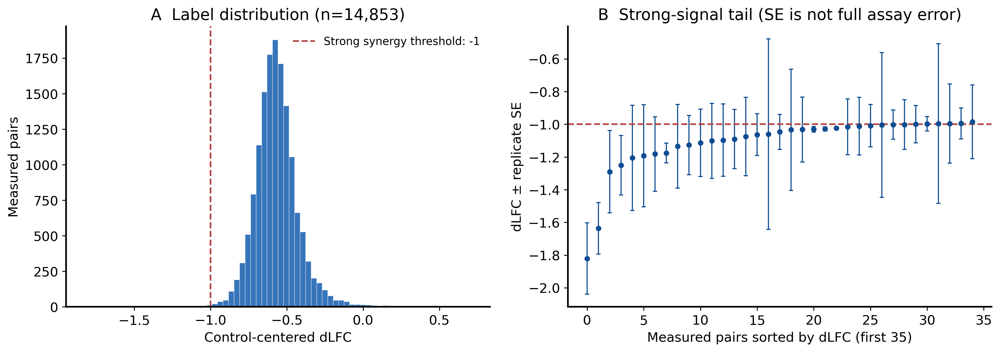
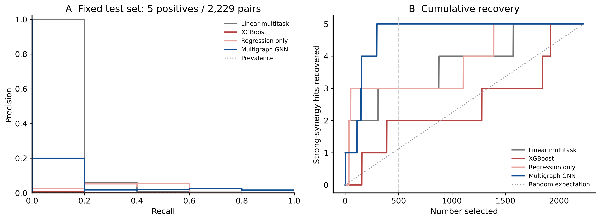
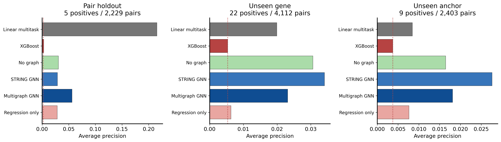
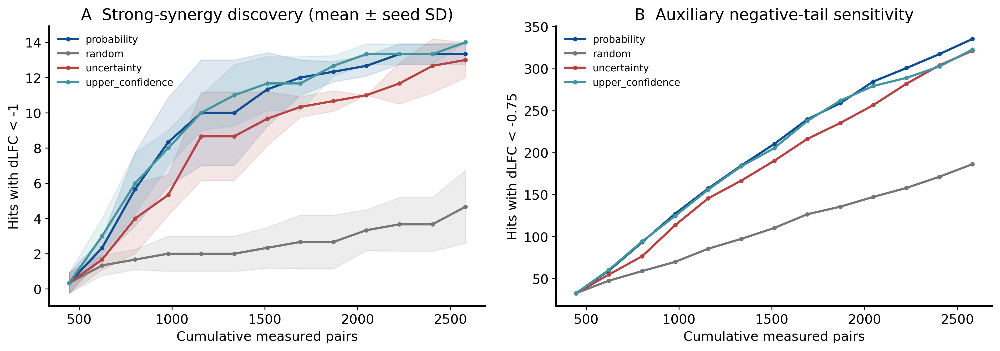
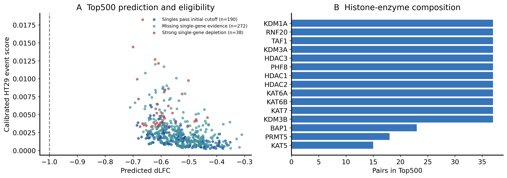

# AI主动学习驱动的“代谢-表观遗传”跨维度合成致死聚焦筛选与奥沙利铂耐药逆转

**干实验阶段报告｜AI模型、主动学习与基因组合交付**

计算流程名称：MetaGene。实验版本：sl_v2_2026-11-05。

## 1. 课题目标与本次干实验成果

总课题围绕结直肠癌奥沙利铂耐药，研究代谢重编程与表观遗传重塑之间的组合脆弱性。通过AI主动学习优选跨通路合成致死组合，衔接聚焦筛选与代表组合验证，评价双基因干预能否恢复奥沙利铂敏感性。

整体研究路径为：**多源数据整合 → AI预测与主动学习 → Top500基因组合交付 → 医学院聚焦筛选与耐药逆转验证 → 实测结果回传与模型更新**。计算团队负责模型、候选排序、解释和更新；医学院团队负责后续湿实验及功能验证。

本次干实验已完成“**同时干预代谢酶与组蛋白修饰酶，预测超出单基因加性预期的协同抑制，形成潜在合成致死候选**”的计算流程，交付Top500排序、Top30短名单、逐对生物学解释及结果回传接口。下文汇报该计算阶段的方法与结果。

**Top500的预测dLFC全部小于0，范围为-0.711至-0.310，中位数为-0.543。** 这意味着当前模型对这500对组合均预测出负向协同效应：双干预后的适应性低于两单基因效应的加性预期。这里评价的是相对预期的协同恶化，无须设定绝对致死水平。

| 计算产出 | 结果 |
|---|---|
| 研究对象 | 38个代谢酶 × 15个直接组蛋白修饰酶 |
| 候选空间 | 570种配对，排除20种既有设计后进入排序550对 |
| Top500预测方向 | 500/500对预测dLFC<0 |
| 交接层级 | Top500（500对）→ Top30（30对）→ Priority8（8对）→ 3对首轮代表组合 |
| 首轮代表组合 | UCK2 × KDM3B、PKM × HDAC2、HK2 × KAT6B |
| 主动学习 | 12轮；上界策略在2,582条测量记录下平均发现14个强协同信号，同预算随机策略约4.67个 |
| 计算规模 | 66次基准拟合、10次最终拟合、156次主动学习拟合 |
| 完整性检查 | 103项通过 |

阅读入口：[Top500](candidates/top500.csv)、[Top30](candidates/top30.csv)、[逐对证据卡](candidates/candidate_evidence_cards.md)、[首轮代表组合](../handoff/first_round_representatives.csv)、[字段字典](candidates/data_dictionary.csv)。每对Top500均附催化功能、组合机制假说、细胞背景信息及来源链接。

## 2. 协同效应的定义

当LFC按共同对照中心化时：

`dLFC = LFC_AB − (LFC_A + LFC_B)`

**dLFC<0表示负向协同，数值越负，双干预相对于加性预期的额外抑制越强。** 单基因效应在加性期望中显式扣除，因而分析对象是组合带来的额外效应。

本研究保留三个不同用途的量：

| 量或阈值 | 用途 |
|---|---|
| 预测dLFC<0 | 判断模型预测的协同方向 |
| dLFC<−1 | 本版主分类头与分类评价使用的强协同事件 |
| dLFC<−0.75 | 辅助分类头与阈值敏感性分析 |
| synergy_probability | 校准后的HT29 dLFC<−1事件分数，用于候选优先级 |

Top500的预测均值处于−1与0之间，表示模型预测有协同抑制。−1用于区分本次训练定义的强协同事件；候选的协同方向按0判断。训练标签、原有评价指标和候选数值均沿用已完成的实验配置。

## 3. 数据处理与模型

### 3.1 重建加性残差

HT29原始LFC以质粒为参照。本次按生物重复和guide位置匹配单基因对照，并加回共同基线：

`dLFC_r = LFC_AB,r − median(LFC_A+control,r) − median(LFC_control+B,r) + median(LFC_control+control,r)`

双非必需基因对照的三个重复中位数分别为-0.1231, -0.0917, -0.1043。先在每个重复内计算残差、平均互换方向，再对有效生物重复求均值；监督标签要求至少2个有效重复。缺测保留为空。

最终监督集合包含14,853对组合，其中29对达到dLFC<−1，27对同时具有重复层面单侧t检验BH q<0.1支持。该统计注释基于聚合基因LFC的重复差异。标签定义见[来源与处理说明](../../data/sl/label_definition.json)，不同基线和阈值的计数见[敏感性分析](label_threshold_sensitivity.csv)。

### 3.2 多源表示与对称模型

模型整合898个基因的1,831维特征：Reactome功能注释、DepMap单敲依赖、TCGA-COAD表达、CRC单细胞表达、HCT116/OxR公开模型通量范围和组蛋白峰描述。STRING、Reactome、BioPlex提供外部网络。基因特征标准化仅使用训练配对涉及的基因。

配对表示由两臂嵌入的和、绝对差及逐元素积构成，交换基因顺序保持预测一致。多图GNN联合学习强协同分类、辅助分类和连续dLFC，损失为加权BCE + 0.25 Smooth-L1 + 0.25配对排序损失。隐藏维96、dropout 0.15、学习率0.001、weight decay 0.0001、batch 2048，最多120轮，18轮早停。

### 3.3 分割与模型选择

主协议按60%/15%/10%/15%划分训练、验证、校准和测试集；固定分割种子101。主测试有2,229对组合、5个强协同阳性；校准集有1,485对、3个强协同阳性。未见配对采用5个训练种子，未见基因和未见锚点采用3个种子。基因留出要求每个测试配对至少一臂未在训练中出现。

按主验证集跨种子平均AUPRC选择多图GNN；全部模型中验证最优为XGBoost。测试评价固定后，对选中模型以原训练+测试集合重新拟合，每个模型5个种子，保留验证和校准集合。候选分数由5个模型集成并进行Platt校准；dLFC名义90%预测区间来自校准集绝对残差，种子SD表示优化随机性。具体配置见[冻结配置](../../configs/experiment_sl.json)。



## 4. 模型评价

以下指标针对**dLFC<−1的强协同识别任务**，用于评价模型在已测配对中发现强信号的能力。候选Top500的dLFC<0方向判断与该分类评价分别报告。

| 模型 | AUPRC | AUROC | Top50强协同命中 | Top500强协同命中 | dLFC RMSE |
|---|---|---|---|---|---|
| linear | 0.2156 | 0.7501 | 2 | 3 | 0.1188 |
| xgb | 0.0030 | 0.5525 | 0 | 1 | 0.1156 |
| graphless | 0.0306 | 0.9029 | 2 | 5 | 0.1199 |
| string | 0.0289 | 0.9023 | 1 | 5 | 0.1198 |
| multigraph | 0.0561 | 0.9366 | 1 | 5 | 0.1194 |
| regression_only | 0.0285 | 0.7652 | 2 | 3 | 0.1138 |

多图GNN的AUPRC为0.0561，AUROC为0.9366；测试集中前50对找回1个强协同阳性，前500对找回5个（测试集共5个）。线性模型在该固定测试集上的AUPRC最高。多图GNN相较仅回归模型具有更高的AUPRC和Top500回收数。逐次结果见[测试指标](test_metrics.csv)，跨种子均值与SD见[汇总](benchmark_summary.csv)。

| 留出方式 | 测试配对 | 强协同阳性 | AUPRC | AUROC |
|---|---|---|---|---|
| pair_holdout | 2229 | 5 | 0.0561 | 0.9366 |
| gene_holdout | 4112 | 22 | 0.0232 | 0.7344 |
| anchor_holdout | 2403 | 9 | 0.0181 | 0.7818 |

主配对留出的基因簇bootstrap AUPRC 95%区间为[0.0054, 0.7997]。对应重采样次数和子集结果分别保存在[区间文件](bootstrap_intervals.json)及[子集评价](subgroup_metrics.csv)。





独立研究采用各来源的命中定义。下表列出未在HT29原始设计中出现的配对；全部可用配对的结果一并保存在[外部评价](external_metrics.csv)。

| 独立数据集 | 未在HT29出现的配对数 | 源定义阳性 | AUPRC | AUROC |
|---|---|---|---|---|
| dede2020_a549 | 12 | 1 | 0.0833 | 0.0000 |
| dede2020_ht29 | 12 | 1 | 0.0833 | 0.0000 |
| dede2020_ovcar8 | 12 | 1 | 0.0833 | 0.0000 |
| in4mer2024_a375 | 79 | 5 | 0.0660 | 0.4405 |
| in4mer2024_a549 | 45 | 1 | 0.0476 | 0.5455 |
| in4mer2024_k562 | 45 | 3 | 0.0540 | 0.1984 |
| in4mer2024_meljuso | 79 | 4 | 0.0625 | 0.4767 |

## 5. 主动学习

在固定训练池的已有真实标签上进行12轮回顾性查询模拟。每个种子下，各策略从相同的5%初始集合出发，每轮增加2%测量预算；本次策略为random、probability、uncertainty、upper_confidence。每轮重新拟合，最多60轮、10轮早停，MC-dropout 12次；验证、校准和测试记录独立保留。

| 采集策略 | 累计测量数 | dLFC<−1命中均值 ± 种子SD | dLFC<−0.75命中均值 |
|---|---|---|---|
| probability | 2582 | 13.33 ± 0.58 | 335.33 |
| random | 2582 | 4.67 ± 2.08 | 186.33 |
| uncertainty | 2582 | 13.00 ± 1.00 | 321.33 |
| upper_confidence | 2582 | 14.00 ± 0.00 | 322.67 |

上界策略在2,582条测量记录下平均发现14个强协同信号，同预算随机策略约4.67个，是随机策略的约3倍。该结果用于评价主动学习安排后续组合查询的能力。图中阴影为3个种子的SD；完整曲线见[主动学习结果](active_learning_curves.csv)。



## 6. 候选排序与生物学解释

候选先按单基因效应条件分层，再按强协同事件分数降序、预测dLFC升序和配对键排序；另保留纯模型分数顺序`synergy_rank`。Top30限制每个基因最多出现3次，Priority8最多2次，首轮3对互不共享基因。

| 单基因分层 | Top500数量 | 交接用途 |
|---|---:|---|
| 两臂有测量且均未触发强耗竭阈值 | 190 | 优先讨论潜在合成致死配对 |
| 至少一臂单基因测量待补充 | 272 | 结合单基因条件开展组合判断 |
| 至少一臂存在强单基因效应 | 38 | 协同抑制／合成病弱扩展 |

单基因阈值采用作者control-scaled标尺≤-0.5。对应文件为[单基因初筛兼容候选](candidates/single_compatible_candidates.csv)、[单基因测量待补充候选](candidates/single_evidence_missing_candidates.csv)和[强单基因背景扩展](candidates/strong_single_synergy_extension.csv)。

| Top30序号 | 代谢酶 | 组蛋白修饰酶 | 预测dLFC | 强协同事件分数 |
|---|---|---|---|---|
| 1 | UCK2 | KDM3B | -0.586 | 0.0084 |
| 2 | UCK2 | KAT7 | -0.638 | 0.0063 |
| 3 | UCK2 | KAT6B | -0.634 | 0.0061 |
| 4 | PKM | HDAC2 | -0.638 | 0.0049 |
| 5 | PKM | HDAC1 | -0.639 | 0.0045 |
| 6 | HK2 | KAT6B | -0.602 | 0.0045 |
| 7 | HK2 | KAT7 | -0.608 | 0.0044 |
| 8 | HK2 | KDM3B | -0.547 | 0.0041 |
| 9 | DHODH | KAT7 | -0.597 | 0.0039 |
| 10 | DHODH | KAT6B | -0.594 | 0.0038 |

首轮代表组合为 **UCK2 × KDM3B、PKM × HDAC2、HK2 × KAT6B**。UCK2参与嘧啶核苷补救，KDM3B参与组蛋白去甲基化，组合假说连接核苷酸稳态与染色质适应；PKM与HK2参与糖酵解，分别与HDAC2的去乙酰化和KAT6B的乙酰化调控配对，形成代谢供给与染色质调节的双重干预方向。逐对说明将已知催化功能、预测效应和机制假说分别写明，并链接功能来源。

Top500中14对具有HCT116/SW480耐药表达关联。DepMap、肿瘤/单细胞表达、模型通量与组蛋白峰提供对应背景信息。耐药关联及单基因数据作为候选讨论依据，配对效应通过合作方的结果回传继续评价。



## 7. 计算结果与课题衔接

本版交付的是**模型预测的潜在合成致死／协同抑制基因组合**，用于总课题的聚焦筛选阶段。训练来自HT29基础生长筛选；20种既有核心设计中，19种只有1个有效匹配重复，1种缺少有效残差，核心配对因此属于模型外推应用（[覆盖表](core_measured_label_coverage.csv)）。主测试和校准分别有5个、3个强协同阳性，Top500目前在外部组合表中未被覆盖。医学院后续在耐药及匹配亲本模型中评价组合效应与奥沙利铂敏感性变化，并将实测结果回传计算团队，推进主动学习闭环。

## 8. 交付与复现

医学院交接入口为[MetaGene GitHub仓库](https://github.com/Tairan-Terrian/MetaGene)。建议依次阅读仓库README、本报告、Top500／Top30及逐对证据卡，再查看交接说明与结果回传模板。网页阅读无需运行模型。

交付包含Top500、Top30、Priority8、首轮代表组合、逐对解释、[500配对靶点表](../handoff/500_pair_targets.csv)、[1,000容量草案](../handoff/1000_slot_capacity_draft.csv)及[真实结果回传模板](../handoff/measured_feedback_template.csv)。容量草案安排500个首设计、450个次设计和50个控制占位；guide由合作方衔接。

回传内容包括细胞模型、亲本/耐药状态、药物条件、重复、单A/单B/双干预及对照LFC、标尺、质控和来源。后续先评价当前预测在新测量上的表现，再将新标签纳入下一轮学习。

103项完整性检查覆盖标签代数、分割隔离、配对交换对称性、候选唯一性、类别、排序、多样性及冻结输入，详见[审计记录](integrity_audit.json)。GitHub提供代码、配置、报告、数据、模型权重和运行结果，大文件使用Git LFS，获取方式见[仓库README](https://github.com/Tairan-Terrian/MetaGene#复现与存储)。以下为计算阶段顺序；设备选择与独立运行目录请按[复现说明](https://github.com/Tairan-Terrian/MetaGene/blob/main/docs/REPRODUCIBILITY.md)执行：

```bash
python scripts/prepare_sl_labels.py
python -u scripts/run_sl_experiments.py --phase all
python scripts/deliver_sl.py
python scripts/analyze_sl.py
python scripts/audit_sl.py
python scripts/make_sl_report.py
python scripts/finalize_sl_release.py
```

GitHub网页可直接阅读结果，也可运行`python scripts/write_sl_documents.py`重新生成阅读文档。报告中的拟合次数汇总已有运行记录；修改模型或配置后，按复现说明在独立运行目录训练并生成新报告。交接直接使用GitHub，不生成交接压缩包。

## 9. 主要来源

- [HT29组合筛选原始研究](https://www.nature.com/articles/s41467-025-67256-9)：原始LFC、实验背景及源分析方法。
- [In4mer原始研究](https://www.nature.com/articles/s41467-024-47795-3)：加性期望、dLFC与源研究评分。
- [组合筛选评分方法研究（2024预印本）](https://pmc.ncbi.nlm.nih.gov/articles/PMC11370406/)：空模型与归一化方法。
- [EpiFactors](https://epifactors.autosome.org/)及候选表中的UniProt链接：组蛋白修饰及催化功能注释。
